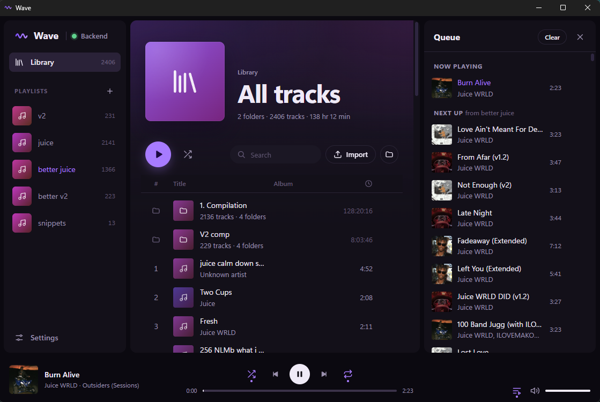
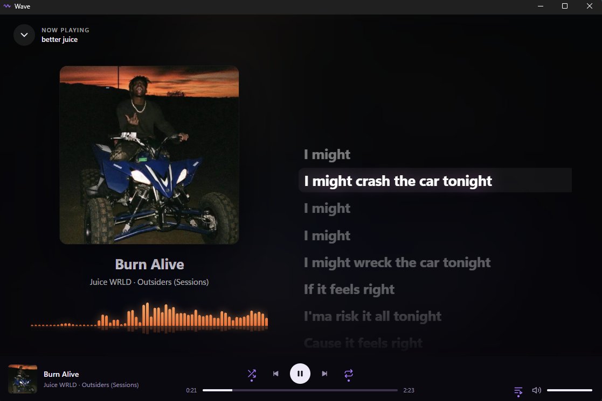
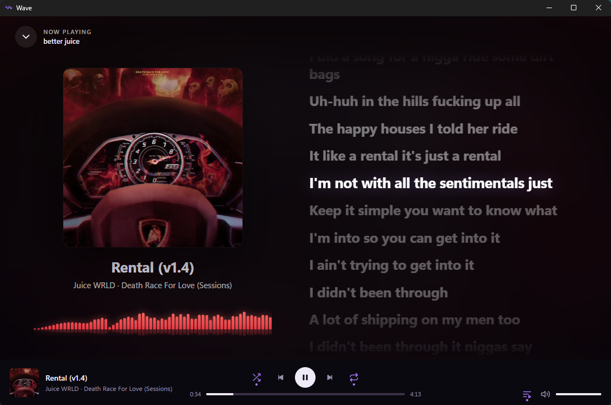
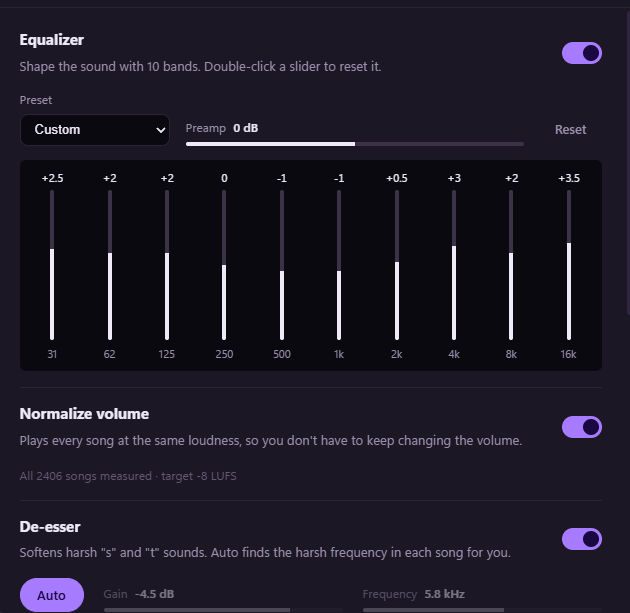
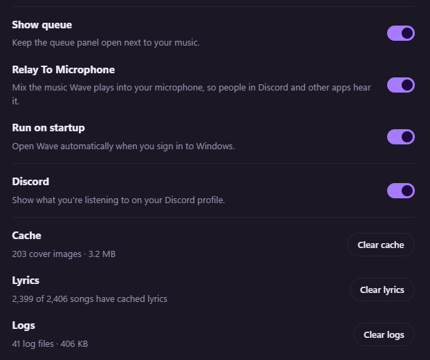

# Wave

Wave is a local music player for Windows. It plays your own audio files with a fast, dark, purple-themed interface, and adds features normally found in streaming apps: synced lyrics that are generated automatically from the music itself, a live audio visualizer, volume normalization, an equalizer and de-esser, Discord Rich Presence, and the ability to play your music into your microphone or a Discord screen share.

Wave is two programs that work together:

| Program | Built with | Job |
|---|---|---|
| `WaveBackend.exe` | C++20 (MSVC, vcpkg) | Library, playback, audio processing, lyrics, everything that stores or decides something |
| `Wave.exe` | Tauri 2 (Rust) + HTML/CSS/JS | The window and interface, plus the final audio output |

The backend owns the logic; the frontend is UI only.

## Screenshots

**Library, playlists and queue**



**Now Playing with synced lyrics and a visualizer tinted by the cover**





**Settings: equalizer, volume normalization and de-esser**



**Settings: queue, mic relay, startup, Discord, cache, lyrics and logs**



---

## Features

### Library and playback
- Import single files or whole folders by drag-and-drop or the Import buttons. Supported: `mp3, wav, ogg, oga, flac, m4a, mp4, mov, aac, opus, webm, weba, wma`.
- Folder tree browsing with breadcrumbs, back/forward history (Alt+←/→, mouse back/forward buttons).
- Playlists: create, rename, delete, add/remove tracks (drag tracks onto a playlist in the sidebar or use the ⋯ menu).
- Titles and artists come from embedded tags; when tags are missing, "Artist - Title" is split out of the filename (or out of the title tag), and a leading track number like `01 - ` is removed.
- Queue panel with "Next in queue", shuffle, repeat (off / all / one), play next, add to queue, jump, and remove.
- The queue and the current song (with its position) are saved and restored when Wave starts again.
- Removing the playing song from a playlist lets it finish instead of skipping it.
- **Skip to vocals** (Settings): starts each song 5 s before the singing begins and moves on 5 s after it ends, using the vocal start/end found by the lyrics pipeline. Until a song has been processed by the current pipeline, the first and last line of its cached lyrics are used instead (it is processed in the background right away); songs with no lyrics at all play normally.
- **Crossfade** (Settings, 0–12 s, 0 = off): blends the end of a song into the next one when the queue advances by itself. Manual skips, Repeat One and the end of the queue cut over normally.
- Type-to-jump: with a list focused, typing a letter jumps to the first song starting with it; pressing it again cycles; typing quickly matches a prefix.
- Keyboard: Space play/pause, ←/→ seek 5 s, Ctrl+←/→ previous/next, Ctrl+A select all, Delete remove, `/` or Ctrl+F search, Esc closes things.

### Now Playing view
- Click the player bar's artwork or title (or the playing song's title in a list) to open a full-screen view. Esc or the ↓ button closes it.
- The cover morphs from where you clicked into a large centerpiece (View Transitions API), with fade and slide animations.
- Full-resolution (1024 px) artwork generated from the file, with a blurred version as the backdrop.
- Synced lyrics: the active line is bright white, others are muted; the active line auto-scrolls to just above center; click a line to seek there; manual scrolling pauses auto-scroll for a few seconds.
- Clean fallbacks: "Lyrics are on the way" (and Wave prioritizes that song), "No lyrics" for instrumentals, and "Lyrics aren't available".
- Real-time frequency visualizer driven by the audio actually coming out of the speakers, tinted with the cover's dominant color.
- Respects reduced-motion settings; works at phone-sized widths.

### Sound
- **Equalizer**: 10 bands (31 Hz – 16 kHz, ±12 dB), preamp, presets.
- **De-esser**: softens harsh "s" and "t" sounds. Manual mode (gain down to −24 dB, frequency 2–12 kHz) or Auto mode, which finds the harsh frequency in each song by itself.
- **Normalize volume**: plays every song at a similar loudness, measured once per song with FFmpeg.
- **Relay To Microphone**: mixes the music into your microphone so people in Discord and other apps hear it.
- **Screen-share audio**: the audio is played by `Wave.exe`, so sharing the Wave window in Discord includes the music.

### Other
- Discord Rich Presence ("Listening to Wave", title, artist, progress).
- Run on startup option.
- Backend status dot in the top-left (green connected, yellow starting, red offline).
- Settings shows cache size, log files, how many songs have cached lyrics, and buttons to clear each.

---

## How the systems work

### Startup and frontend ↔ backend communication

1. `Wave.exe` opens its window immediately, then `launcher.rs` looks for a running backend on the named pipe `\\.\pipe\waveport`. If none answers, it starts `WaveBackend.exe` from its own folder.
2. The backend opens a TCP server on `127.0.0.1` with a random free port and writes that port number to the pipe.
3. The frontend connects to that port. One TCP connection carries everything; if it drops, the frontend reconnects and the status dot turns yellow/red. When the frontend disconnects, the backend shuts down cleanly.

**Wire format.** Every message is a frame: a `u32` little-endian length, then the payload. A payload is a `u8` message type, a `u16` value count, then the values. Values are bit-packed, each prefixed by a 4-bit type tag (bool, u8…u64, i8…i64, f32, f64, string). The C++ side lives in `Bits.hpp` / `Messages.hpp`, the Rust side in `bits.rs` / `lib.rs`, and the two must stay in the same order.

**Requests and events.** The JavaScript UI calls Tauri commands (`invoke("get_lyrics", …)`); Rust turns each into a framed request and waits for the reply of the same type. The backend also pushes events without being asked: `PlayerState` (play/pause/position), `QueueState`, and `Spectrum` (visualizer frames). Rust forwards those to the page as Tauri events (`wave-player`, `wave-queue`, `wave-spectrum`).

Message types: `ImportFile, ImportFolder, GetFileTree, Play, Pause, Resume, Seek, SetVolume, Stop, PlayerState, GetCover, GetCovers, GetPlaylists, CreatePlaylist, DeletePlaylist, RenamePlaylist, AddToPlaylist, RemoveFromPlaylist, QueueSet, QueueNext, QueuePrevious, QueueJump, QueueRemove, QueuePlayNext, QueueAdd, QueueClear, SetShuffle, SetRepeat, QueueState, GetQueue, GetSettings, SetEqualizer, ClearCache, SetDiscordPresence, RemoveFromLibrary, SetInterface, GetPlayerState, SetRunOnStartup, SetMicRelay, ClearLogs, SetDeEsser, SetNormalize, GetNormalize, GetLyrics, SetVisualizer, Spectrum, GetArtwork, ClearLyrics`.

### Data storage

Everything lives in `%LOCALAPPDATA%\Wave`:

| File / folder | Contents |
|---|---|
| `filehashmap.json` | Every song (keyed by a SHA-256 of its path): tags, duration, cover key, display title/artist, lyrics status, version and timed lines |
| `filetree.json` | The folder structure of the library |
| `playlists.json` | Playlists |
| `queue.json` | The queue, current song and position |
| `settings.json` | All settings |
| `loudness.json` | Per-song loudness measurements for Normalize volume |
| `covers\` | Shared 256 px cover thumbnails (identical covers are stored once using a perceptual hash and color match) |
| `models\` | The lyrics models (downloaded automatically) |
| `logs\` | One log file per backend run |

The file list sent to the frontend leaves out the lyrics themselves (only their status), so opening Wave doesn't transfer the lyrics of the whole library.

### Playback and the audio path

The backend plays files with the Windows Media Foundation media engine. Its own audio effect (`Equalizer::Transform`, an `IMFTransform`) sits in the playback chain and processes every chunk of audio, in this order:

1. **Normalize** – a fixed per-song gain (see below).
2. **Equalizer** – 10 peaking biquad filters plus preamp.
3. **De-esser** – dynamic band cut.
4. The processed audio is copied to the **mic relay** and the **audio relay**.

**Crossfade.** The backend runs two media engines, each with its own effect chain (and its own normalize gain). At the fade point (song end, or the skip-to-vocals end, minus the fade length) the next song starts on the idle engine. Seeking into the last few seconds also starts the fade, shortened to the time left. Each engine applies its own S-curve gain; the incoming song's audio is buffered (about 0.1 s) and mixed into the outgoing song's stream, so the relays keep one continuous stream. The fade gains always sum to at most 1, so the mix never gets louder than the louder song. When the outgoing song has faded out, the incoming engine takes over the relay stream and its timeline is joined to the old one, so `Wave.exe` neither jumps nor drops audio. Pausing pauses both songs; seeking or changing songs mid-fade cancels it.

**Audio relay (playing through `Wave.exe`).** Discord's window share captures audio per process, so the sound has to come out of `Wave.exe`, not the backend. The backend writes the processed audio into a shared-memory ring buffer (`Local\WaveAudioRelay4`, about 11 seconds at 192 kHz) together with timing anchors (which ring frame belongs to which media time), the playback clock, play/pause state and volume. `audio_relay.rs` in `Wave.exe` reads it on a high-priority thread and plays it through WASAPI on the default speakers:
- It works out which frame should be heard right now from the anchors and clock, and starts exactly at the point playback started (the backend marks a precise start frame on every play, resume, seek and song change, so nothing is skipped).
- It corrects tiny clock drift by occasionally skipping or repeating a single sample.
- It writes back a heartbeat; while the heartbeat is fresh, the backend silences its own output. If `Wave.exe` stops, the backend's own audio comes back within ~0.4 s.
- It also publishes which frame is coming out of the speakers right now, which the visualizer uses.
- It opts out of Windows background power throttling so a share in Discord doesn't cause dropouts.

**Normalize volume.** Each song is decoded once with FFmpeg and run through the `ebur128` filter to measure integrated loudness (LUFS) and true peak; results go to `loudness.json`. Up to 3 low-priority background threads measure the library, with the playing song first. During playback the gain moves the song to the target (−8 LUFS), boosting by at most 6 dB and never past the point where peaks would clip. The gain switches instantly on a song change and eases in if a measurement finishes mid-song.

**De-esser.** A band-pass filter isolates the harsh band; its level is compared with the full signal against an adaptive baseline of that song's normal level, so only spikes are reduced (`out = x + (gain − 1) · band`). Auto mode watches six detectors between 3.5 and 10.5 kHz and glides toward the one that spikes during harsh moments, cutting up to 10 dB.

### Synced lyrics

Lyrics are made locally from the audio, with no internet lookup.

**Models** (downloaded automatically to `models\` on first run, over HTTPS with WinHTTP; each file must match its exact size and a pinned SHA-256 before it is used, otherwise it is deleted and retried 10 minutes later):

| Model | Source | Used for |
|---|---|---|
| `Kim_Vocal_2.onnx` (MDX-Net) | Ultimate Vocal Remover's official model repo | Vocal separation |
| `ggml-large-v3-turbo-q5_0.bin` (Whisper) | whisper.cpp's official Hugging Face repo | Transcription |

**Pipeline, per song:**
1. **Load** – FFmpeg decodes the file and applies `loudnorm=I=-16:TP=-1.5:LRA=11`, resampling to 44.1 kHz stereo.
2. **Separate** – Kim Vocal 2 runs through ONNX Runtime with DirectML on the GPU (STFT size 7680, hop 1024, 3072 bins × 256 frames per chunk; the FFT uses FFmpeg's `av_tx`). Only the vocals are kept.
3. **Find the singing** – the vocals are measured in 20 ms frames to find where singing is actually audible. The first and last stretch longer than 0.3 s that is loud enough to be singing (the same −36 dBFS / 16 dB-below-reference level as the quiet-segment check below, so instrumental bleed doesn't count) is saved as the song's vocal start/end, which **Skip to vocals** uses. If a song's lyrics finish while it is playing, its skip points are applied right away.
4. **Transcribe** – whisper.cpp (Vulkan GPU backend) transcribes the vocals in chunks of up to 28 s that begin and end in silence. The language is detected once per song, on the chunk with the most singing, and reused for every chunk; this saves one encoder pass per chunk compared with per-chunk auto-detection. If a chunk with steady singing comes back with too few words (Whisper sometimes gives up on a window and skips it), it is split at its quietest point and re-transcribed, recursively. Known Whisper hallucinations and symbol-only output are dropped.
5. **Time the words** – DTW word timestamps are snapped onto the audible vocals, kept in order, and given realistic durations.
6. **Drop quiet segments** – each Whisper segment is checked against the loudness of the separated vocals under it (20 ms frames, in dBFS). A segment is dropped when its loudest frame is below −36 dBFS or more than 16 dB below the song's vocal reference (the 98th-percentile frame level). This removes words Whisper invents from instrumental bleed, such as "Thank you" over a beat. Measured on 11 songs (895 lines): invented lines peaked 17–38 dB below the reference and at −31.8 dBFS or quieter. Every real line was within 14.3 dB of the reference and at −29.2 dBFS or louder.
7. **Build lines** – a dynamic-programming optimizer picks line breaks over the whole word stream. It rewards real pauses, punctuation, Whisper's sentence ends, clause starts like "I…", and internal rhymes kept together; it penalizes pauses inside a line, lines over ~45 characters, one-word fragments, and lines ending on words like "to" or "my". Each line gets its own start and end time.
8. **Store** – lines are saved in `filehashmap.json` with a pipeline version number.

**Queue.** Two background workers process songs, but only one transcribes at a time: running two Whisper decodes at once on one GPU was 2–4× slower than running them in turn, especially when VRAM is tight, so the second worker loads and separates the next song while the first transcribes. Songs are taken in this order: the playing song first, then the next 50 songs in play-queue order (following shuffle and repeat), then the rest of the library. Songs already done with the current pipeline are skipped; songs done by an older version keep their old lyrics until they are redone at the end. Typical speed on an RTX-class GPU is around 10–20 s per song. Each finished song logs its time per stage (`load`, `separate`, `wait`, `transcribe`).

The Now Playing view asks for a song's lyrics with `GetLyrics`, highlights by playback position (projected forward smoothly between backend updates), and polls while lyrics are still being made.

### Visualizer

While the Now Playing view is open, the backend's `Visualizer` thread reads the last 16,384 samples ending at the frame `Wave.exe` is playing right now, applies a Hann window and FFT (`av_tx`), and groups the result into 64 bands spaced evenly in pitch from 30 Hz to 16 kHz (with a +3 dB/octave tilt so treble is visible). Frames are pushed to the frontend ~30 times a second as `Spectrum` messages; the page draws them at 60 fps with fast-rise/slow-fall smoothing, glow and a reflection. When playback pauses it sends one silent frame and the bars settle.

**Bar color** comes from the cover's dominant color: the cover is shrunk to 32×32, near-black pixels are ignored, and the strongest hue (weighted toward bright, saturated pixels) is used, unless white/gray covers clearly more of the image, in which case the bars are white. Songs without a cover use the default purple.

### Relay To Microphone

This plays the music into your real microphone so every app (Discord, games, etc.) hears it, without a virtual audio driver.

- **The effect.** `WaveMicApo.dll` is a Windows Audio Processing Object (an audio effect that Windows' audio engine loads into the microphone's capture path). It is registered as an endpoint effect on each active microphone, which also applies in "raw" capture mode, the mode Discord uses.
- **Installing.** Turning the setting on asks for admin once. The backend re-launches itself elevated with `--mic-relay-install`, copies the DLL to `Program Files\Wave`, registers the effect, patches each microphone's effect settings (backing up the originals so uninstall restores them), and restarts the Windows audio service.
- **Feeding it.** The backend writes the processed music into a second shared ring buffer (`Global\WaveMicRelay3`) with timing anchors and the playback clock. The effect, running inside Windows' audio engine, mixes it into your voice.
- **Quality.** The effect resamples with a Lanczos-8 windowed-sinc filter, applies a soft limiter, and keeps sync with gentle ±0.2% rate correction.
- **Echo cancellation.** The music in the mic plays 200 ms *ahead* of your speakers, so Discord's echo cancellation doesn't mistake it for speaker echo and strip it out.

### Discord Rich Presence

The backend talks to the Discord client over its local IPC pipes and updates the activity as you play, pause and change songs (title, artist, album as the large-image text, progress).

---

## Building

Requirements:
- Visual Studio 2026 (MSVC, v145 toolset)
- vcpkg with MSBuild integration (`vcpkg integrate install`) and the static triplet `x64-windows-static`, with `ffmpeg`, `whisper-cpp[vulkan]`, `ggml[vulkan]`, `cryptopp` and `nlohmann-json` installed
- Rust with the Tauri CLI (`cargo tauri`)

ONNX Runtime and DirectML (from Microsoft's NuGet packages `Microsoft.ML.OnnxRuntime.DirectML` and `Microsoft.AI.DirectML`) are already included in `Dependencies\onnxruntime-directml` (`include`, `lib`, `bin`), so they don't need to be installed.

Run `builder.bat` from the project root. It:
1. builds `backend\WaveBackend.slnx` (the backend and `WaveMicApo.dll`) in Release x64,
2. builds the Tauri frontend,
3. closes any running Wave, then packages everything into `.\Wave`: `Wave.exe`, `WaveBackend.exe`, `WaveMicApo.dll`, and the ONNX Runtime / DirectML DLLs copied from `Dependencies\`.

The backend links the C runtime and all libraries statically, so it only needs the three Microsoft DLLs next to it. Vulkan comes from the graphics driver.

## Project layout

```
backend/                 C++ backend (WaveBackend.exe)
  main.cpp               startup, message handling, shutdown
  Components/Components/
    AppData              library, playlists, queue cache, lyrics storage
    Player, Queue        playback (Media Foundation) and the play queue
    Equalizer            the audio effect: normalize, EQ, de-esser, relays
    Normalize, DeEsser   loudness normalization, de-essing
    AudioRelay           shared-memory audio for Wave.exe
    MicRelay             microphone relay install + feed
    Lyrics, ModelStore   lyrics queue and model downloads
    AudioLoader, Separator, Transcriber   lyrics pipeline stages
    Visualizer           spectrum frames
    Metadata             tags, covers, cover colors
    TcpSocket, IPC, Messages, Bits        frontend communication
  Discord/               Discord Rich Presence
MicRelay/                WaveMicApo.dll (the microphone effect) and its shared buffer layout
Dependencies/            bundled ONNX Runtime + DirectML (headers, import libraries, DLLs)
docs/screenshots/        images used in this README
frontend/
  src/                   index.html, main.js, styles.css (the interface)
  src-tauri/src/         lib.rs (commands, events), launcher.rs (starts/connects the backend),
                         audio_relay.rs (plays the audio), bits.rs, taskbar.rs, file_drop.rs
builder.bat              one-step build and packaging
```

---

## Credits

All of the frontend was written by Claude Opus 5.5, and about 80% of the backend was written by Claude Opus 5.5. All or most of the system ideas were inspired by the project's author.

Third-party components: FFmpeg, whisper.cpp / ggml (MIT), ONNX Runtime and DirectML (Microsoft), the Kim Vocal 2 MDX-Net model (Ultimate Vocal Remover), Crypto++, nlohmann/json, and Tauri.

---

*This README was generated by Claude Opus 5.5.*
